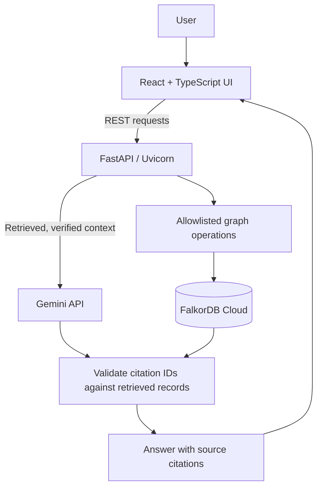
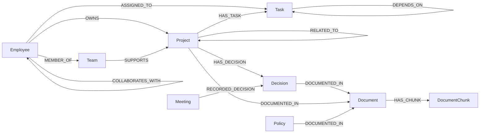
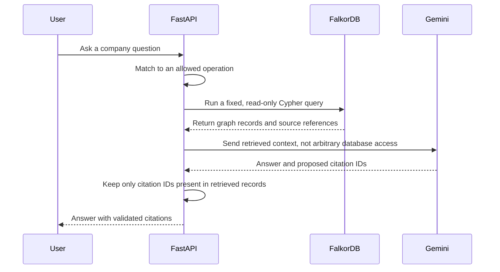

# Company Brain

**Company Brain** is Nexora Technologies' graph-backed company knowledge assistant. It connects employees, teams, projects, tasks, meetings, decisions, policies, and source documents in **FalkorDB Cloud**. Users ask questions in natural language; the backend retrieves verified graph context through allowlisted, read-only Cypher operations, then uses Gemini to explain that context with validated source citations.

> **Core principle:** FalkorDB is the source of truth for company knowledge. The LLM explains retrieved records; it does not invent graph queries or replace the database.

## Contents

- [Overview](#overview)
- [Features](#features)
- [Architecture](#architecture)
- [Tech stack](#tech-stack)
- [Graph data model](#graph-data-model)
- [How question answering works](#how-question-answering-works)
- [Local setup](#local-setup)
- [Configure environment variables](#configure-environment-variables)
- [Run the application](#run-the-application)
- [Seed the graph](#seed-the-graph)
- [Try the API](#try-the-api)
- [Cypher queries and graph traversals](#cypher-queries-and-graph-traversals)
- [Documents and source traceability](#documents-and-source-traceability)
- [Testing and verification](#testing-and-verification)
- [Troubleshooting](#troubleshooting)
- [Security notes](#security-notes)
- [Project structure](#project-structure)

---

## Overview

### The problem

Company knowledge is spread across project trackers, meeting notes, policies, tasks, and documents. Keyword search alone often fails to answer questions that cross multiple facts—for example, who owns a project, which team supports it, what is blocked, which decision was made, and what document supports that decision.

### The solution

Company Brain represents company information as a **property graph**. The graph links people, teams, projects, tasks, meetings, decisions, policies, and documents. For a question, the backend selects a known retrieval operation, queries FalkorDB, and gives the resulting context to Gemini. Returned citation IDs are checked against records actually retrieved from the graph.

### Implemented capabilities

- Dashboard with graph counts, task status totals, recent decisions, and recent meetings.
- AI Assistant with suggested questions, grounded answers, conversation history, safe fallback behavior, and source citations.
- Pages for Projects, People & Teams, Tasks, Meetings & Decisions, Knowledge Explorer, Documents, and Settings.
- Interactive graph explorer showing supported node labels and directed relationships.
- Protected, idempotent seed for the fictional Nexora company graph.
- Multi-file uploads for TXT, Markdown, JSON, PDF, and DOCX.
- Uploaded documents stored as `Document` and `DocumentChunk` nodes in FalkorDB.
- JSON validation and pretty-print normalization before persistence.
- SHA-256-based upload IDs, per-file errors, partial-success batches, and upload size limits.
- Server-side secrets; database and API credentials are not sent to frontend code.

## Architecture



The frontend and FastAPI backend are served together by the backend process on port `3000`. The graph database is a separately reachable FalkorDB endpoint; it is not a local SQL database.

## Tech stack

| Layer | Technology |
|---|---|
| Frontend | React 18, React DOM, Vite, TypeScript, CSS |
| Icons and graph visualization | `lucide-react`, `react-force-graph-2d` |
| Backend/API | Python 3.12+, FastAPI, Uvicorn |
| Graph access | FalkorDB Cloud using `redis-py` and `GRAPH.QUERY` |
| AI answer generation | Gemini API through server-side `httpx` requests |
| Request/data validation | Pydantic |
| Document extraction | `pypdf`, `python-docx` |
| Tests | `pytest` |

## Graph data model

The graph name is configured with `FALKORDB_GRAPH_NAME` (the example uses `companyos`). The application uses stable IDs and `MERGE` conventions. The current implementation does not declare database-level uniqueness constraints or indexes.

### Node labels

| Node | Properties used by the code |
|---|---|
| `Employee` | `id`, `name`, `role`, `email`, `location` |
| `Team` | `id`, `name`, `description` |
| `Project` | `id`, `name`, `status`, `priority`, `description`, `dueDate` |
| `Task` | `id`, `title`, `status`, `priority`, `dueDate`, `description` |
| `Meeting` | `id`, `title`, `date`, `summary` |
| `Decision` | `id`, `title`, `date`, `status`, `reason` |
| `Policy` | `id`, `name`, `summary`, `updatedAt` |
| `Document` | `id`, `title`, `sourceType`, `sourceRef`; uploaded documents may also include `filename`, `mimeType`, `sizeBytes`, `checksum`, `uploadedAt`, `extractedText`, `textLength`, `contentTruncated` |
| `DocumentChunk` | `id`, `documentId`, `position`, `content` |

Seed source references use `nexora://...`; uploaded source references use `upload://doc-upload-<sha256-prefix>`.

### Directed relationships



| Relationship | Meaning |
|---|---|
| `Employee -[:MEMBER_OF]-> Team` | Employee belongs to a team |
| `Employee -[:OWNS]-> Project` | Employee owns a project |
| `Employee -[:ASSIGNED_TO]-> Task` | Employee is assigned to a task |
| `Team -[:SUPPORTS]-> Project` | Team supports a project |
| `Project -[:HAS_TASK]-> Task` | Project contains a task |
| `Task -[:DEPENDS_ON]-> Task` | One task depends on another |
| `Project -[:HAS_DECISION]-> Decision` | Decision is associated with a project |
| `Meeting -[:RECORDED_DECISION]-> Decision` | Meeting records a decision |
| `Decision -[:DOCUMENTED_IN]-> Document` | Document supports a decision |
| `Project -[:DOCUMENTED_IN]-> Document` | Document supports a project |
| `Policy -[:DOCUMENTED_IN]-> Document` | Document is a policy source |
| `Project -[:RELATED_TO]-> Project` | Projects are related |
| `Employee -[:COLLABORATES_WITH]-> Employee` | Employees collaborate |
| `Document -[:HAS_CHUNK]-> DocumentChunk` | Uploaded document contains a chunk |

A standalone Mermaid source is available at [`docs/company-brain-graph.mmd`](docs/company-brain-graph.mmd).

## How question answering works



1. A deterministic intent fallback handles recognizable questions where possible.
2. If the intent is unclear, Gemini selects from a predefined list of operations. It is instructed not to write Cypher.
3. The backend dispatches to a fixed function in `server/graph_queries.py`.
4. FalkorDB returns connected project, owner, team, task, decision, and document records as appropriate.
5. Gemini receives the retrieved context and drafts an explanation.
6. The backend intersects returned citation IDs with IDs from the retrieved context. Unsupported citation IDs are discarded.
7. If FalkorDB is unavailable, the API reports an error/degraded state rather than silently substituting mock graph data.

## Local setup

### Prerequisites

- Node.js 20 or newer
- pnpm 10.15.0 (the version declared by the repository)
- Python 3.12 or newer
- A reachable FalkorDB Cloud database or compatible FalkorDB endpoint
- A Gemini API key for AI answer generation
- An admin key for graph seeding and document uploads

Docker is optional for running the application image. The supplied Compose file runs the app only and does not start a local graph database.

### 1. Get the code

```bash
git clone <YOUR_PUBLIC_GITHUB_REPOSITORY_URL>
cd <REPOSITORY_DIRECTORY>
```

Replace the placeholders with the repository URL and folder name.

### 2. Install pnpm if needed

```bash
corepack enable
corepack prepare pnpm@10.15.0 --activate
pnpm --version
```

### 3. Create a Python virtual environment

**Windows PowerShell:**

```powershell
py -3.12 -m venv .venv
.\.venv\Scripts\Activate.ps1
python -m pip install -r requirements.txt
```

If PowerShell blocks activation, use the virtual environment interpreter directly:

```powershell
.\.venv\Scripts\python.exe -m pip install -r requirements.txt
```

**macOS/Linux:**

```bash
python3 -m venv .venv
source .venv/bin/activate
python -m pip install -r requirements.txt
```

### 4. Install frontend dependencies

From the repository root:

```bash
pnpm install
```

## Configure environment variables

Create a local `.env` file from the example.

**Windows PowerShell:**

```powershell
Copy-Item .env.example .env
notepad .env
```

**macOS/Linux:**

```bash
cp .env.example .env
```

Set real values locally. Do not commit `.env`.

| Variable | Purpose |
|---|---|
| `ADMIN_API_KEY` | Required for protected graph seed and document upload routes |
| `FALKORDB_GRAPH_NAME` | Graph name passed to `GRAPH.QUERY`; example: `companyos` |
| `FALKORDB_HOST` | Reachable FalkorDB hostname |
| `FALKORDB_PORT` | FalkorDB Redis-compatible port; code default is `50420` |
| `FALKORDB_USER` | Database username; code default is `falkordb` |
| `FALKORDB_PASSWORD` | Database password |
| `FALKORDB_TLS` | Set to `true` when the provider requires TLS |
| `GEMINI_API_KEY` | Server-side Gemini API key |
| `CORS_ORIGINS` | Optional comma-separated allowed browser origins; default is `http://localhost:3000` |
| `PORT` | Optional application port; default is `3000` |

Use `.env.example` as the source of truth for exact variable names. The application does not use `DATABASE_URL` or a local SQL database.

### Load `.env` into the shell

If the repository does not load `.env` automatically, export the values before starting it.

**macOS/Linux:**

```bash
set -a
source ./.env
set +a
```

**Windows PowerShell:**

```powershell
Get-Content .env | ForEach-Object {
  if ($_ -match '^\s*([^#][^=]*)=(.*)$') {
    $name = $matches[1].Trim()
    $value = $matches[2].Trim()
    [Environment]::SetEnvironmentVariable($name, $value, 'Process')
  }
}
```

This simple loader is intended for `KEY=value` lines. If you add quoted or multiline values, use a proper dotenv loader and verify the result. Never paste real secrets into public issues or chats.

### Local app versus cloud database

The app can run locally while connecting to FalkorDB Cloud. In that case, `FALKORDB_HOST` must be the endpoint supplied by the database provider—not `127.0.0.1` unless the database is actually running in the same network namespace as the backend.

A cloud preview cannot automatically reach your personal laptop's `localhost`. Use a reachable, private database endpoint and follow provider network-access and TLS guidance. Do not expose a database publicly just to make a preview work.

## Run the application

With dependencies installed and environment variables configured:

```bash
pnpm dev
```

The repository's `dev` script builds the frontend and starts FastAPI/Uvicorn on port `3000`.

Open:

- App: http://localhost:3000
- Health check: http://localhost:3000/api/health
- API documentation: http://localhost:3000/api/docs

The Vite-only preview command (`pnpm preview`) runs on port `4173`; it is not the complete full-stack startup path.

### Verify the health check

```bash
curl http://localhost:3000/api/health
```

A healthy response should report `status: "ok"` and `databaseConnected: true`. If configuration is missing or FalkorDB cannot be reached, the API should report a degraded/unavailable state. A loaded UI alone is not proof that the database is connected.

Other checks:

```bash
curl http://localhost:3000/manus-routes.json
pnpm typecheck
pnpm build
python -m compileall -q server
```

## Seed the graph

The seed operation is explicit and protected. It does not run automatically on startup. It uses stable IDs and `MERGE` conventions and does not reset or delete graph data.

With environment variables loaded:

```bash
pnpm seed
```

Equivalent Python command:

```bash
python -m server.seed
```

Or use the protected HTTP endpoint:

```bash
curl -X POST http://localhost:3000/api/admin/seed \
  -H "X-Admin-Key: YOUR_ADMIN_API_KEY" \
  -H "Content-Type: application/json" \
  -d '{"confirm":true}'
```

Replace the placeholder locally; do not commit the key.

The fictional Nexora seed currently defines 15 teams, 36 employees, 16 projects, 70 tasks, 19 meetings, 19 decisions, 3 policies, and 23 seed documents. Live dashboard counts can differ if other graph records or uploaded documents exist.

## Try the API

### List projects

```bash
curl http://localhost:3000/api/projects
```

### Get blocked tasks

```bash
curl "http://localhost:3000/api/tasks?blocked=true"
```

### Ask a grounded question

```bash
curl -X POST http://localhost:3000/api/chat \
  -H "Content-Type: application/json" \
  -d '{"question":"Who owns Project Lighthouse, what is its status, and which source documents support the answer?"}'
```

The response depends on current graph contents and includes answer/context metadata and available validated citations.

### Upload a source document

Create `lighthouse-note.txt` with a fictional note:

```text
Project Lighthouse is blocked on reporting lineage. Yara owns the project.
```

**macOS/Linux:**

```bash
curl -X POST http://localhost:3000/api/documents/upload \
  -H "X-Admin-Key: YOUR_ADMIN_API_KEY" \
  -F 'files=@lighthouse-note.txt;type=text/plain'
```

**Windows PowerShell:**

```powershell
curl.exe -X POST http://localhost:3000/api/documents/upload `
  -H "X-Admin-Key: YOUR_ADMIN_API_KEY" `
  -F "files=@lighthouse-note.txt;type=text/plain"
```

The server extracts the text, creates a `Document` node and `DocumentChunk` nodes, and connects each chunk with `HAS_CHUNK`. The example content is fictional.

## Cypher queries and graph traversals

Read operations are defined in `server/graph_queries.py`. The assistant selects an allowlisted operation in `server/ai_agent.py`; it does not run arbitrary Cypher generated by Gemini.

### 1. Count nodes by label

```cypher
MATCH (n)
RETURN labels(n)[0] AS label, count(n) AS total
```

**Purpose:** Dashboard graph counts.  
**Input:** None.  
**Output:** A row for each node label and its count.

### 2. List projects, owners, and task counts

```cypher
MATCH (p:Project)
OPTIONAL MATCH (owner:Employee)-[:OWNS]->(p)
OPTIONAL MATCH (p)-[:HAS_TASK]->(t:Task)
RETURN p.id AS id,
       p.name AS name,
       p.status AS status,
       p.priority AS priority,
       p.description AS description,
       p.dueDate AS dueDate,
       owner.name AS owner,
       count(t) AS taskCount
ORDER BY p.name
```

**Purpose:** Project list with owner and task count. The application can add a name filter when a search term is provided.

### 3. Retrieve connected project context

This multi-node traversal supports questions that combine ownership, teams, tasks, decisions, and documents.

```cypher
MATCH (p:Project)
OPTIONAL MATCH (owner:Employee)-[:OWNS]->(p)
OPTIONAL MATCH (owner)-[:MEMBER_OF]->(team:Team)
WITH p, owner, collect(DISTINCT team.name) AS teams
OPTIONAL MATCH (p)-[:HAS_TASK]->(t:Task)
WITH p, owner, teams,
     collect(DISTINCT CASE
       WHEN t.id IS NOT NULL
       THEN t.id + '|' + t.title + '|' + t.status + '|' + t.priority + '|' + t.dueDate
       ELSE ''
     END) AS taskRows
OPTIONAL MATCH (p)-[:HAS_DECISION]->(d:Decision)
WITH p, owner, teams, taskRows,
     collect(DISTINCT CASE
       WHEN d.id IS NOT NULL
       THEN d.id + '|' + d.title + '|' + d.date + '|' + d.status + '|' + d.reason
       ELSE ''
     END) AS decisionRows
OPTIONAL MATCH (p)-[:DOCUMENTED_IN]->(doc:Document)
RETURN p.id AS id,
       p.name AS name,
       p.status AS status,
       p.priority AS priority,
       p.description AS description,
       p.dueDate AS dueDate,
       owner.id AS ownerId,
       owner.name AS ownerName,
       owner.role AS ownerRole,
       teams,
       taskRows,
       decisionRows,
       collect(DISTINCT CASE
         WHEN doc.id IS NOT NULL
         THEN doc.id + '|' + doc.title + '|' + doc.sourceType + '|' + doc.sourceRef + '|' + coalesce(doc.summary, '')
         ELSE ''
       END) AS documentRows
ORDER BY p.name
```

The application parses task, decision, and document rows into a structured context. The query is a graph traversal across multiple related node types, not a vector search.

### 4. Explore graph nodes

```cypher
MATCH (n)
WHERE labels(n)[0] IN [
  'Employee', 'Team', 'Project', 'Task',
  'Decision', 'Meeting', 'Document'
]
RETURN n.id AS id,
       labels(n)[0] AS type,
       coalesce(n.name, n.title) AS label,
       coalesce(n.status, '') AS status
```

A second query returns directed edges for the Knowledge Explorer.

### 5. Persist uploaded documents and chunks

The ingestion implementation uses `MERGE` to upsert a document and chunk, then creates the `HAS_CHUNK` edge. Conceptually:

```cypher
MERGE (d:Document {id: $document_id})
SET d += {
  id: $document_id,
  title: $title,
  filename: $filename,
  sourceType: $source_type,
  sourceRef: $source_ref,
  mimeType: $mime_type,
  sizeBytes: $size_bytes,
  checksum: $checksum,
  uploadedAt: $uploaded_at,
  extractedText: $extracted_text,
  textLength: $text_length,
  contentTruncated: $content_truncated
}
```

```cypher
MERGE (c:DocumentChunk {id: $chunk_id})
SET c += {
  id: $chunk_id,
  documentId: $document_id,
  position: $position,
  content: $content
}
WITH c
MATCH (d:Document {id: $document_id})
MERGE (d)-[:HAS_CHUNK]->(c)
```

See `server/document_ingest.py` for the actual query construction and parameters. Review that implementation before adding new ingestion operations.

### Safety and performance

- Keep assistant access limited to allowlisted operations.
- Validate and bound search input.
- Never concatenate untrusted user input into Cypher.
- The current project uses graph traversals and aggregations; do not claim vector search, embeddings, or advanced path algorithms unless separately implemented.
- Stable IDs are enforced by application convention and `MERGE`; this repository does not declare database-level uniqueness constraints or indexes.

## Documents and source traceability

Supported extensions: `.txt`, `.md`, `.markdown`, `.json`, `.pdf`, and `.docx`.

- JSON is validated and normalized before persistence.
- Upload IDs use SHA-256-derived values.
- Each file is limited to 10 MB; each batch is limited to 50 MB.
- Mixed batches can report partial success and per-file errors.
- Document metadata and extracted text are stored in FalkorDB.
- `Document` nodes connect to `DocumentChunk` nodes through `HAS_CHUNK`.
- Assistant citation IDs are checked against the IDs returned in the retrieved context.

The application does not use a local SQL database, local vector database, or in-memory graph fallback.

## Testing and verification

Run from the repository root:

```bash
python -m pytest -q tests
python -m compileall -q server
pnpm typecheck
pnpm build
```

The provided project notes report these results from earlier verification:

- Python tests: `7 passed`
- Python compilation succeeded
- TypeScript type checking succeeded
- Vite production build succeeded
- Earlier live integration checks against a configured FalkorDB endpoint successfully exercised seeding, dashboard reads, and grounded chat/source citations

These are previously reported results, not a claim that tests have just been rerun on every machine. Run the commands locally before submission and preserve your actual output.

Docker build/Compose checks, public deployment verification, incognito access checks, and demo recording were not completed in the referenced documentation pass.

## Troubleshooting

### Health endpoint reports `degraded`

- Ensure environment variables are set in the same process that starts the backend.
- Verify host, port, username, password, graph name, and TLS configuration.
- Confirm the database is reachable from the backend runtime.
- Inspect `/api/health` for non-secret status information.

### Graph routes return `503`

The backend is running, but a graph query failed. Check network access, authentication, graph name, port, and TLS. Do not substitute mock data.

### Seed returns `401`

Use the exact `X-Admin-Key` header and include `{"confirm":true}` in the request body.

### Upload returns an error

Check the file extension, readability, JSON validity, 10 MB per-file limit, and 50 MB batch limit.

### UI loads without graph data

Call `/api/health`. If the database is connected but the graph is empty, run the protected seed command and reload the dashboard. If the frontend uses another origin, configure `CORS_ORIGINS`.

## Security notes

- Keep `.env` out of Git; commit only placeholder values in `.env.example`.
- Keep `FALKORDB_PASSWORD`, `GEMINI_API_KEY`, and `ADMIN_API_KEY` on the server.
- Seed and upload routes require `X-Admin-Key`.
- Gemini receives retrieved context; it does not have direct database access.
- The API uses allowlisted graph operations and validates citation IDs against retrieved records.
- Do not expose the graph database publicly just to connect a cloud preview.
- Review the TLS certificate verification configuration in `server/db.py` before stricter production deployment.


## Project structure

```text
.
├── frontend/
│   └── src/
│       ├── api.ts
│       ├── App.tsx
│       └── styles.css
├── server/
│   ├── main.py
│   ├── config.py
│   ├── db.py
│   ├── graph_queries.py
│   ├── seed_data.py
│   ├── document_ingest.py
│   ├── ai_agent.py
│   └── prompts.py
├── docs/
│   └── company-brain-graph.mmd
├── tests/
├── .env.example
├── Dockerfile
├── docker-compose.yml
├── package.json
├── requirements.txt
└── README.md
```

Some files may differ by branch. Treat the checked-out repository as the source of truth.
